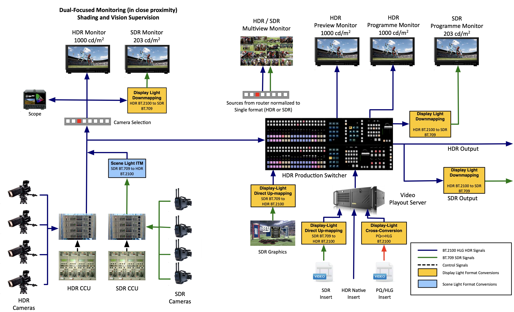
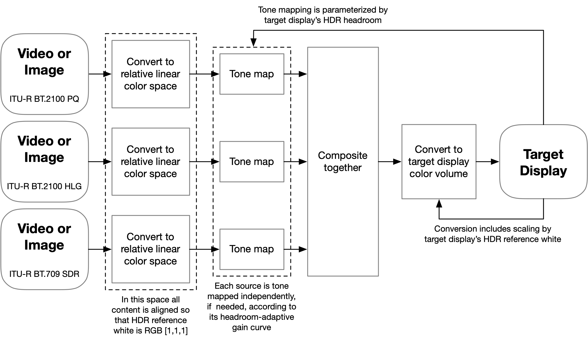
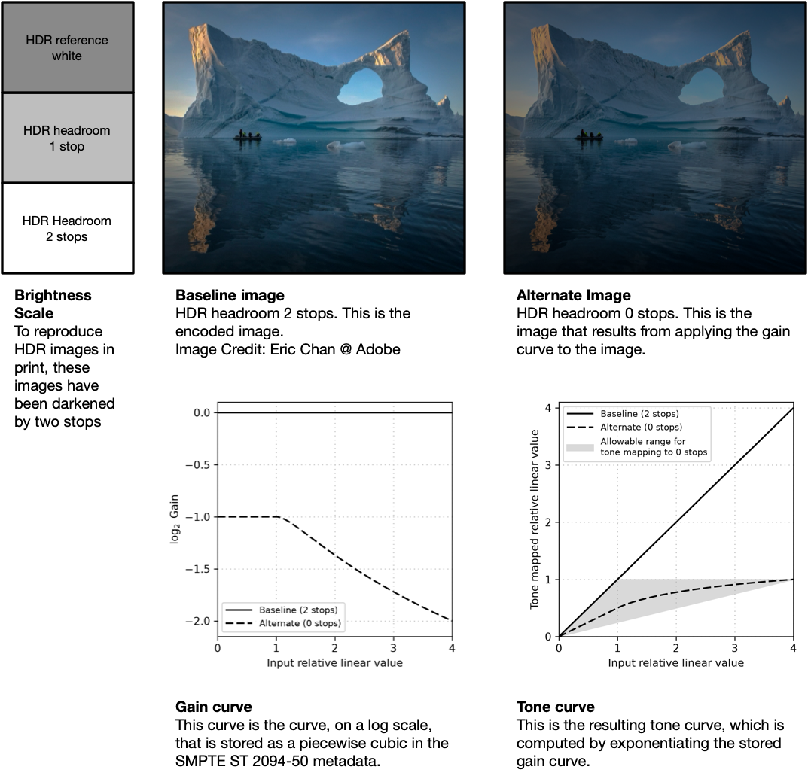
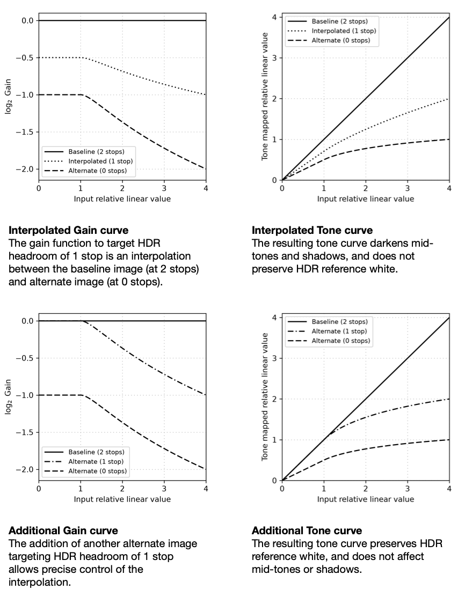
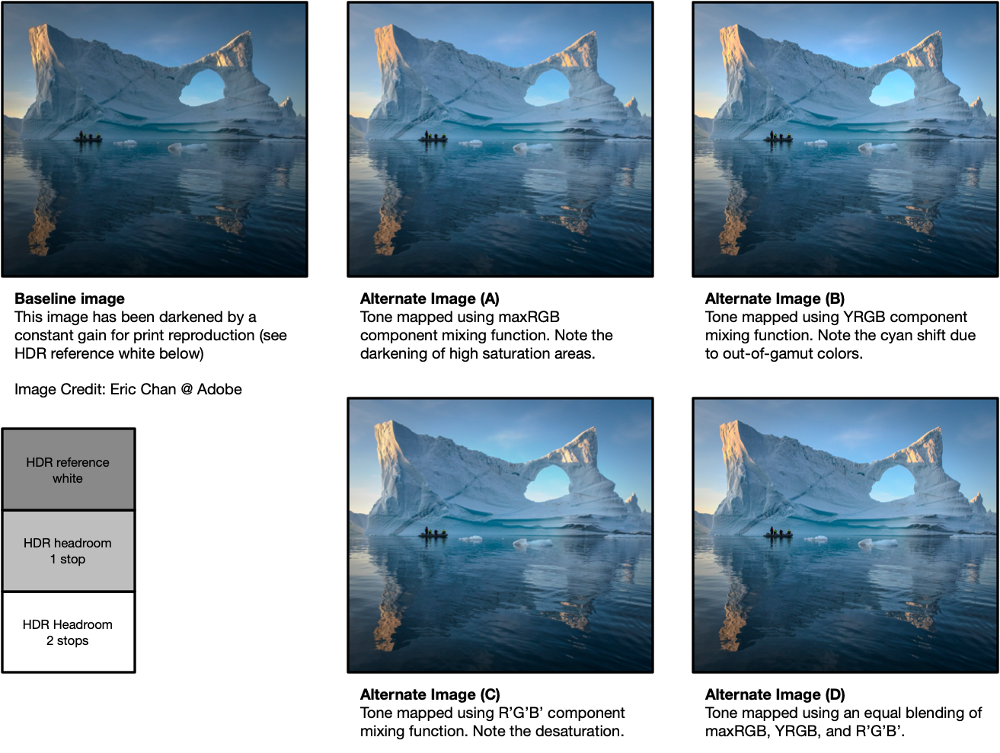

# Introduction

Capture and distribution of High Dynamic Range (HDR) video has grown steadily over the last decade.
HDR was first adopted in professional production (cinema, broadcast), but it is now routinely captured by consumer devices such as phones.
On the display side, nearly all recent displays support HDR input, however on-screen quality can vary greatly due to differences in display capabilities.
To improve the quality of experience across display capabilities, several HDR dynamic metadata formats have been standardized and widely adopted.
These solutions were designed for a full-screen experience, thus they do not consider other media (SDR or HDR) or user-interface elements sharing the screen.
To address this gap in the HDR video ecosystem, the broadcast and computing industries jointly developed the SMPTE ST 2094-50 standard, which was recently published and is the subject of this article.

We first cover the historical context and convergence of problems that led to the collaboration on this project.
We then describe the SMPTE ST 2094-50 compositing model, the relative linear color space in which it operates, and the parameters that drive it: HDR reference white, HDR headroom, and Headroom-Adaptive Gain Curves (HAGC).
Advanced topics and applications follow.
We conclude with ecosystem integration and future directions.

# Motivation and Historical Context

The SMPTE ST 2094-50 standard was developed to address problems and standardize practices
that arose independently in two different areas of the industry: live broadcast and compositing on computing devices.

Both of these areas independently found the need for a model for HDR and SDR compositing that provides:

- Consistent alignment between HDR and SDR content
- Consistent adaptation of HDR content to display capabilities
- Single-master representation of content for display on both HDR and SDR devices

## Live Broadcast Using Single-Master HDR/SDR and Reference White

Early live HDR productions used separate HDR and SDR production paths. This approach was difficult to sustain and led broadcasters to develop single-master HDR workflows, in which HDR becomes the primary production format and SDR is derived from it using controlled, static conversions. These workflows were documented and refined in ITU-R Report BT.2408.

For a single-master production to composite cohesively, HDR and SDR sources must maintain a predictable and coherent brightness relationship. This relationship is anchored at reference white (defined in detail in the HDR Reference White section below): the conversions between HDR and SDR are designed to map white to white. As a result, SDR content keeps its intended appearance when it is placed in an HDR program, and an SDR derivative of the HDR program remains consistent with it.

Figure N shows how this works in a typical live sports production. Native HDR cameras feed the production switcher directly (blue path), while SDR cameras are brought into the HDR domain with a static scene-light conversion (SDR BT.709 to HDR BT.2100). SDR sources that are already display-referred, such as on-air graphics and SDR video files, are upmapped into HDR with a display-light direct up-mapping. Everything is then composited in HDR at the switcher. For dual distribution, the native HDR program is sent to HDR monitors and distribution as is, and a static display-light down-mapping (HDR BT.2100 to SDR BT.709) produces the SDR version (green path) for SDR monitors and distribution. Because every conversion keeps reference white aligned, an SDR source can make a roundtrip conversion from SDR to HDR and back to SDR while preserving its intended appearance.

**Figure N: Typical Live Sport Single Master Production Workflow**

This approach has been highly successful, and has since been widely deployed and refined across live broadcast and streaming productions.
What this approach lacks is a mechanism for signaling which conversion parameters to use, and the ability to apply dynamic conversions across changing scene conditions and across displays with different capabilities.
The SMPTE ST 2094-50 standard aims to address these gaps.

## Compositing on Computing Devices

On modern computing devices such as laptops, tablets, and phones, video is rarely viewed in isolation. Modern operating systems display multiple applications on-screen simultaneously, often alongside user interface elements, text content, images and videos. Even when video is the only content on-screen, it is very common for the video to switch frequently between multiple content streams.
When HDR content was introduced into this ecosystem, it immediately presented two issues relating to the consistent rendering of HDR and SDR content together.

First, there was no universal way to align the luminance of HDR content with the SDR white of the operating system compositor.
In reference environment, SDR white was placed at 80 cd/m² (sRGB, IEC 61966-2), 100 cd/m² (ITU-R BT.1886) or 203 cd/m² (ITU-R BT.2408), depending on the system.
Systems also differed in how the alignment held when SDR brightness changed with user settings or ambient light:
some scaled HDR and SDR together while others left HDR fixed while SDR adjusted.

Second, the method used to adapt HDR content to a display's capabilities was often delegated to the operating system.
The operating system either implemented ad-hoc methods or variants of different recommendations (e.g., ITU-R BT.2408 Annex 5, ITU-R BT.2446).
This approach led to inconsistent rendering across systems, but also across versions of the same system.
Furthermore, the content author had no control over, and no way to signal a preference for, the method applied.
To alleviate this issue, dynamic metadata, such as SMPTE ST 2094-10 or SMPTE ST 2094-40, have been designed around adapting to a display peak.
However these metadata do not accomodate a reference white and thus are sub-optimal to composite content together and adapt to a constantly varying brughtness slider but constant peak.

Finally, just as live broadcast required a single-master workflow in production, computing devices require a single-master representation for distribution and playback.
Computing systems often have several displays of different capabilities attached at once,
and a single video stream may be dynamically re-targeted to different displays or mirrored on several displays simultaneously.
On such systems, a single-master representation for both HDR and SDR is needed to allow this re-targeting.

All the described issues have been recently addressed in the still image domain which were quickly adopted across the industry.
ISO 21496-1 HDR gain maps solved these core problems with a new image representation: an SDR base image, inherently aligned with SDR white, plus a gain map that defines the rendering for each display's capabilities.
ISO 22028-5 took a different approach: it builds on the single-layer HDR encodings of ITU-R BT.2100 (PQ or HLG), standardizes reference white and recommends which tone mapping to use.
For the computing industry, SMPTE ST 2094-50 aims to extend this success from still images to the video domain.

# The SMPTE ST 2094-50 Metadata and Compositing Model

The core of the SMPTE ST 2094-50 specification is a compositing model,
driven by content-specified metadata.

In this section, we provide an overview of the compositing model,
followed by a deep dive into the core concepts that it is based on.

## Compositing Model

The compositing model of SMPTE ST 2094-50 relies on two kinds of input:
- Content metadata defined by SMPTE ST 2094-50.
- Display properties determined by the display device or the operating system's compositor.

Figure N illustrates the compositing model where each content source is brought into a relative linear color space with 1.0 the HDR Reference White and, if needed, tone mapped to the display's capabilities.
The processed images are then composited, and the resulting composite is converted to the target display color volume by aligning the composite value 1.0 to the display HDR reference white.

**Figure N: The SMPTE ST 2094-50 Compositing Model**

In this pipeline, for each content source, the SMPTE ST 2094-50 metadata specifies:
- the HDR reference white value for that content source, used for mapping into a relative linear color space
- the HDR headroom of that content source, used to determine if tone mapping is required
- the headroom-adaptive tone curve used to compute the tone mapping for the target display

The display has two properties that are not specified by SMPTE ST 2094-50 metadata:
- the HDR reference white value used for mapping from a relative linear color space to display luminance
- the HDR headroom, which, compared with that of the content, determines whether tone mapping is required and how much

Note that HDR reference white and HDR headroom apply to both content and displays, and the following sections define them for each.

## HDR Reference White

HDR reference white is the luminance level used as an anchor to align source content inside the SMPTE ST 2094-50 Compositing Model relative linear space.
At the input of the compositing model, the content HDR reference white is normalized to 1.0 in the relative linear color space.
At the output of the compositing model, the value 1.0 of the relative linear color space is mapped to the display HDR reference white.
Overall, the content HDR reference white is mapped to the display HDR reference white, so that white in the content appears as white in the viewing environment.

### Content HDR Reference White

Content being composited may have its own HDR reference white value, specified in its SMPTE ST 2094-50 metadata.
Although it often relates to the scene content, HDR reference white is always a display-referred value.
<!-- Nicolas concerned about relate to scene content and then common value is 203. We shoudl clarify-->

For HDR content, HDR reference white is often equal to the display luminance of a diffuse reflector at the center of the scene, on the reference display described in ITU-R BT.2100 or ISO 22028-5.
ITU-R BT.2100 defines this level as the “level obtained from an HDR camera and a 100% reflectance white card”.
ISO 21496-1 and ISO 22028-5 define it as the “level that would typically result from a 100% Lambertian reflector placed at the center of interest within a scene under controlled lighting”.
A commonly used value for HDR reference white is 203 cd/m², as suggested in ITU-R BT.2100, ITU-R BT.2408, and MovieLabs Best Practices.

Pixel values above HDR reference white should be used selectively for intentional highlights (such as reflections and emissive objects) while keeping the overall image balance anchored near HDR reference white.
Large bright regions above HDR reference white can dominate the presentation.
The viewer then adapts to them, and other content, such as SDR white, may appear gray instead of white.
This could break the balance between HDR and SDR content on the same screen.

For SDR content, HDR reference white is always equal to the luminance level of the nominal peak SDR signal.
In SDR color grading, a diffuse reflector at the center of the scene often has a display luminance slightly below the nominal peak.

For user interface elements, HDR reference white follows the behavior of SDR content and equals the luminance level of the UI or CSS color white.

### Display HDR Reference White

A display that is rendering composited content has its own HDR reference white.
The HDR reference white of a display is defined as the displayed luminance of a nominal peak SDR signal.
On some operating systems, this value is not exposed to applications, because the operating system itself performs the final step of the compositing pipeline: converting to display luminance.

The value of a display's HDR reference white varies significantly, primarily with the viewing environment.
Many TVs, laptops, tablets and phones have an ambient light sensor that adjusts the “screen brightness.”
This changes the display's HDR reference white.

When the HDR reference white is being driven by an ambient light sensor, modern operating systems will often attempt to adjust the display's HDR reference white to match the luminance of a diffuse reflector in the viewing environment.
If this matching is done effectively, reading black text on a white background on the display is equivalent to reading black text on a white sheet of paper.
This is important because a mismatch would force the viewer's eye to adjust between the display and the surroundings, causing discomfort.

Note that this model of viewing environment stands in contrast to the viewing environments in the ITU-R BT.2100 and ISO 22028-5 standards, which prescribe a viewing environment with a surround (the area that can affect adaptation of the eye) of 5 cd/m².
The SMPTE ST 2094-50 metadata specifying content's HDR reference white bridges the gap between these two viewing environment models.
<!-- This is not clear and I am not sure I agree with how it is presented. I think we should remove it rather than add confusion as this part is complicated. Nicolas +1-->
HDR content can specify, in its HDR reference white metadata, the luminance the viewer perceives as diffuse white in the content.
The compositing model then aligns the content with the luminance the viewer perceives as diffuse white in the display viewing environment.

## Relative Linear Color Space

Compositing and tone mapping in SMPTE ST 2094-50 are done in what is called a relative linear color space.
A relative linear color space is a unitless linear color space where all content has been aligned so that the HDR reference white maps to the value 1.0.

For compositing operations in any linear color space, the color primaries of the space do not affect the results, and so are not specified (the primaries from ITU-R BT.2020 are a reasonable default).
For nonlinear tone mapping operations, the selection of color primaries does affect the result, and each content source specifies the color primaries for the relative linear color space in which it is to be tone mapped in the SMPTE ST 2094-50 metadata.

### Converting to Relative Linear Space

Content sources converted into relative linear color space by first converting to linear display light for a reference display (in cd/m²).
For PQ content, this means applying the reference EOTF.
For HLG content, this means applying the reference EOTF for a 1000 cd/m² reference display.
<!-- Nicolas: should we cover color conversion-->
For ITU-R BT.709 content, this means applying the nonliner gamma recommended in ITU-R BT.1886 and scaling by the content HDR reference white.
Finally, light levels are converted to the unitless relative linear color space by dividing by the content's HDR reference white (in cd/m²).

Note that for SDR content (including sRGB and ITU-R BT.709), because the content's HDR reference white is equal to its nominal peak luminance, the scaling in the EOTF and the subsequent division by HDR reference white cancel out, and the nominal peak SDR signal always maps to the value 1.0.

### Converting to Display Luminance

After tone mapping and compositing in the relative linear color space, the composited image is converted to linear luminance on the target display (in cd/m²) by multiplying by the display's HDR reference white (in cd/m²).
This maps the value 1.0 in the relative linear color space to the display's HDR reference white luminance. <!-- Ronan: this feels repetitive-->

For content that is composited without tone mapping (or with a tone mapping that leaves the RGB value [1,1,1] unchanged), this means that the content's HDR reference white will be displayed at a luminance equal to the display's HDR reference white.
For content that is composited with a tone mapping that modifies the RGB value [1,1,1], this property will not hold (see further discussion in the advanced topics section).

Many displays and operating systems will also perform nonlinear adjustments, rather than just the linear multiplication (e.g., guided by the viewing environment).
Such adjustments are outside the scope of SMPTE ST 2094-50.

## HDR Headroom

In the SMPTE ST 2094-50 specification, HDR headroom is defined as the ratio between peak luminance and the luminance of HDR reference white, expressed as a $\log_2$ value. Expressed as a formula, this is

$$
\text{HDR headroom} =
\log_2
  \left(\frac
    {\text{Peak luminance}}
    {\text{HDR reference white luminance}}
  \right)
$$

Expressing this ratio as a $\log_2$ value means that HDR headroom is measured in photographic stops above HDR reference white.
An HDR headroom of 1 means that peak luminance is twice HDR reference white, an HDR headroom of 2 means four times HDR reference white, and so on.

In the case of SDR, the peak luminance is equal to HDR reference white.
There are zero stops of headroom above HDR reference white, and the HDR headroom is $\log_2(1) = 0$.

<!-- Nicolas: remove this paragraph-->
In some contexts, it is useful to refer to this ratio in linear space rather than $\log_2$ space (e.g., when discussing pixel values in the relative linear color space).
While HDR headroom is expressed as a $\log_2$ value by default, the linear ratio may be used when explicitly referred to as linear HDR headroom.

As with HDR reference white, the concept of HDR headroom applies both to content and to displays.

### Content HDR Headroom

The HDR headroom of content is defined as $\log_2$ of the ratio between the peak luminance in the content and the content's HDR reference white luminance.

This is often computed as the $\log_2$ of the maximum color component of the content in the relative linear color space.
For video content, it is common to perform some temporal smoothing (e.g., setting the HDR headroom for all frames in a scene to the peak computed HDR headroom across the entire scene), and so the content HDR headroom may be a ceiling above the actual pixel values.

### Display HDR Headroom

The HDR headroom of a display is defined as $\log_2$ of the ratio between the display's peak luminance and the display's HDR reference white luminance.

The HDR headroom of a display can change substantially over time. As discussed above, the HDR reference white for a display (the denominator for the HDR headroom) can be significantly affected by the viewing environment. Similarly, the peak luminance of a display (the numerator for the HDR headroom) can also vary (e.g., due to power and thermal limitations, or user settings).
When a display's HDR headroom changes during playback, the display or compositor should adapt smoothly over time to avoid unpleasing brightness fluctuations.

The HDR capability of a display is characterized by its HDR headroom. Whether or not a display is capable of HDR is no longer a fixed property, nor is it a binary capability. Instead, the HDR capability of a display is a continuum, with SDR displays where HDR headroom is zero as one endpoint,
and the specification's maximum HDR headroom of 6 stops as the other.
(This limitation of 6 stops is for display-referred content. Such a limit would be inappropriately low for scene-referred content).

## Tone Mapping Using Headroom-Adaptive Gain Curves

Prior to compositing, each content source should be adapted to the target display's capabilities.

If the display's HDR headroom is greater than or equal to the content's HDR headroom, then no tone mapping is needed.
Content should not be stretched to fill the display's available HDR headroom just because the capability is there --
the goal of HDR in the context of SMPTE ST 2094-50 is to make content better, not brighter.

When the content's HDR headroom exceeds the display's HDR headroom, however, the content must be tone mapped to fit within the display's available headroom.

(Note that this describes the most common use case for SMPTE ST 2094-50 metadata.
The specification allows for brightening content using inverse tone mapping and HDR-to-HDR tone mapping,
as described in the advanced topics section).

### Baseline and Alternate Images

SMPTE ST 2094-50 allows the author to specify one or more color grades of content, targeting different HDR headrooms in metadata.

The color grading that is always present is the content as it was originally encoded (with no transformations applied to it),
and is called the *baseline image*.
The content's HDR headroom is referred to as the *baseline HDR headroom*.
(These are the same terms used in ISO 21496-1).

The other (non-baseline) color-graded renderings of the content are called *alternate images*,
and the HDR headroom of each color-graded rendering is called the *alternate image HDR headroom*.
Rather than specifying the full pixel representation of each color grade (as is done in ISO 21496-1 gain map images),
SMPTE ST 2094-50 represents each alternate image as a global (not spatially varying) tone mapping transformation to apply to the baseline image.

This transformation is called a *color gain function*, and is parameterized by a *component mixing function* and a *gain curve*.
The component mixing function (discussed in the advanced topics section) combines a pixel's RGB values in relative linear space into a driving value.
The gain curve maps that driving value to a gain by which to scale the baseline image's color components to produce the alternate image.

The gain curve is represented as a piecewise cubic function in the $\log_2$ domain, and can express a wide range of tone mapping behaviors.
It is important to note that the purpose of the gain curve is only to tone map the source image, with the baseline HDR headroom, to the alternate image's HDR headroom.
<!-- Nicolas: move to Content HDR Headroom-->
One may be tempted to perform viewing-environment adjustments such as lifting dark tones in the gain curve because
such adjustments are sometimes baked into traditional HDR-to-SDR conversions (because SDR is often viewed in a brighter environment compared with HDR), but in SMPTE ST 2094-50, nonlinear viewing environment adaptation is considered to be a separate and out-of-scope topic.

The following figure shows an example of this tone mapping,
including the gain curve stored in the metadata and the resulting tone curve.
In the tone curve plot, the shaded region indicates the allowable range of tone curves targeting 0 stops of headroom, bounded above by a hard clip and below by a constant gain.
To represent up to 2 stops of HDR headroom in a print medium, both the baseline and alternate images are darkened by 2 stops (mapping HDR reference white to gray and 2 stops of headroom to peak print white, as shown in the brightness scale).

**Figure N: Example baseline image, alternate image, and the gain curve and tone mapping curve that produced them**

### Interpolating Between Baseline and Alternate Images

Together, the baseline image and the alternate images define authored color grades at a discrete set of HDR headrooms.

If the target display's HDR headroom happens to match one of the authored headrooms, that rendition is used directly (e.g., targeting an SDR display when one of the alternate images specified in metadata targets an HDR headroom of 0).
<!-- Nicolas: could not decode nicolas comment--> To adapt the content to a specific target display HDR headroom that does not exactly match one of the specified color grades.

Rather than rendering multiple full alternate images and blending their pixels, SMPTE ST 2094-50 performs this interpolation directly on the gain curves.
For any target display HDR headroom between two authored headrooms,
the tone mapped image is produced by taking a weighted average of the two corresponding color gain functions in the $\log_2$ domain
(treating the baseline image as having a constant $\log_2$ gain of 0),
and applying the resulting interpolated gain to the baseline image.
The interpolation weights are computed such that the
resulting tone mapping function maps the content's baseline HDR headroom to the exact HDR headroom of the display.

# SMPTE ST 2094-50 Advanced Concepts and Applications

## Using Multiple Alternate Images
<!-- Nicolas: ??-->
The previous example contained a baseline image (the encoded color grading, which uses an HDR headroom of 2 stops) and a single alternate image (a tone mapping to SDR at an HDR headroom of 0 stops).
This provides a default interpolation between the two color gradings, for any targeted HDR headrooms between 0 and 2 stops.
SMPTE ST 2094-50 allows for specifying multiple alternate images (up to 4) to allow fine-grained control over how the color grading adapts to intermediate headrooms.
This can be used to carefully control the trade-offs between preserving detail in highlights (areas brighter than HDR reference white) and preserving the brightness and contrast of mid-tones and shadows (areas darker than HDR reference white).

Consider the interpolated tone mapping of the above example to an HDR headroom of 1 stop.
Because the tone mapping that is being used for interpolation compresses highlights, mid-tones, and shadows, the interpolated result will compress all these areas of the picture, just slightly less.
If the color grader wishes for the tone mapping to an HDR headroom of 1 stop to, for example, preserve mid-tones and shadows and only compress highlights, this can be accomplished by including an alternate image at an HDR headroom of 1 stop.
Because this preserves values at and below HDR reference white (leaving the RGB value [1,1,1] unchanged), it also ensures that the content's HDR reference white remains aligned with the display's HDR reference white.

The following figure shows the tone mapping curve and resulting tone mapped image for the above example using the simple interpolation, and then using an artist-specified interpolation that only compresses highlights.

**Figure N: Gain and tone mapping curves from default interpolation and explicit specification**

## The Reference White Tone Mapping Operator

The Reference White Tone Mapping Operator (RWTMO) was introduced in ISO 22028-5 as a default tone mapping to use for images that provided no prescriptive tone mapping metadata.

RWTMO generates two alternate images, using the above-described technique to exert fine-grained control over highlights, mid-tones and shadows.
One of the alternate images tone maps to SDR (an HDR headroom of 0).
In this tone mapping the mid-tones and shadows of the image are linearly scaled, and the highlights are compressed using a nonlinear curve.
The second alternate image tone maps to an intermediate HDR headroom.
This intermediate HDR headroom is estimated to be the minimum HDR headroom that can be tone mapped by compressing highlights but completely preserving mid-tones and shadows.

The binary encoding of SMPTE ST 2094-50 metadata provides a compact encoding to indicate to use RWTMO.
This can be used to specify the tone mapping to use in a minimal number of bytes.

## Inverse Tone Mapping and HDR-to-HDR Tone Mapping

The baseline image is the one that is encoded directly by pixels,
and therefore it is the color grading that is most precisely specified (as opposed to the alternate images that are computed by the application of a tone mapping curve).
In the previous examples, the baseline image has been the HDR image rendered at the maximum HDR headroom, but
SMPTE ST 2094-50 allows for alternate images to target HDR headrooms that are higher than the baseline HDR headroom,
which can be used in workflows including the following.

### Inverse Tone Mapping

The term *inverse tone mapping* refers to a workflow where the baseline image is encoded as SDR (e.g., using ITU-R BT.709) and alternate images are specified to tone map to higher HDR headrooms.
Inverse tone mapping can be considered if the SDR rendering of the video is of paramount importance, or if backwards compatibility (enabling rendering even by HDR-unaware software) is critical,
but it comes with significant risks, and should be used with caution.

One danger of inverse tone mapping is that it can produce excessively bright large-area objects.
Because the tone mapping curve is applied globally, a curve meant to enhance reflections or light sources may also amplify white walls, clouds, snow, graphics, or other broad bright objects.
These regions can become excessively bright, changing the image's visual balance and making viewing uncomfortable.

Another danger of inverse tone mapping is that it can produce banding (especially if the baseline image is 8-bit), by increasing the visibility of existing quantization steps.
Processing at higher precision avoids introducing further quantization errors but does not restore tonal detail lost in the source.

### HDR-to-HDR inverse Tone Mapping
<!-- Ronan: Did we cover HDR HDR Tone Mapping?-->
The term HDR-to-HDR tone mapping refers to a workflow where the baseline image is already HDR, but alternate images specify how to tone map to higher HDR headrooms than the baseline HDR headroom.
This technique comes with fewer risks compared to SDR to HDR inverse tone mapping, but should be used deliberately.

The availability of greater display HDR headroom does not, by itself, justify brighter rendering.
Expansion should reflect an authored intent and be reviewed to avoid excessively luminous large-area objects, unintended color changes, and amplification of source artifacts.

## The Component Mixing Function

For a given alternate image, the component mixing function combines a pixel's RGB values in relative linear space into a driving value
which is mapped by the gain curve to a $\log_2$ gain by which to scale the baseline image's color components to
produce the alternate image.

This combination is a weighted sum (with non-negative coefficients summing to 1) of
the red, green, and blue components
($k_\text{red}$, $k_\text{green}$, and $k_\text{blue}$),
the maximum and minimum of the components
($k_\text{max}$ and $k_\text{min}$),
and the component itself
($k_\text{component}$).

A very common driving value is the maximum component,
which can be selected by setting the coefficient $k_\text{max}=1$.
This corresponds to the *maxRGB* method described in ITU-R BT.2408 Annex 5.
This method preserves the chrominance of the original image and
remains within the original image's color gamut,
but can darken the image.

Another common driving value is luminance,
which can be selected by setting the coefficients for red, green, and blue to the components of luminance in the relative linear color space in which the gain curve is applied
(if this space uses the ITU-R BT.2020 primaries, then this would mean setting the coefficients
$k_\text{red}=0.2627$, $k_\text{green}=0.678$, and $k_\text{blue}=0.0593$).
This corresponds to the *YRGB* method described in ITU-R BT.2408 Annex 5.
This method preserves the chrominance of the original image
without excessive darkening,
but can produce colors far outside of the original image's color gamut
which need to be handled by gamut mapping methods outside of the scope of SMPTE ST 2094-50.

Another less common driving value is the value of each color component itself,
which can be selected by setting the coefficient $k_\text{component}=1$.
In this method, the gain function is evaluated on the red, green, and blue components of each pixel independently.
This corresponds to the *R'G'B'* method described in ITU-R BT.2408 Annex 5.
This method will remain within the original image's color gamut,
but can significantly desaturate the image and can shift the hue of colors in the image.

As discussed in ITU-R BT.2408 Annex 5, these methods can be blended together to control their various trade-offs.
This can be done by blending their coefficients in the SMPTE ST 2094-50 metadata.

The below image shows the result of tone mapping using each of the three discussed methods, and an equal blending of the three methods.
The baseline image is darkened by two stops, as in previous illutrations,
but the possible alternate images are not darkened, to ensure the visibility of the parameters' effects.

**Figure N: Illustration of Component Mixing Function**

There are some benefits to ensuring that the $k_\text{component}$ coefficient be zero for some workflows.
If this coefficient is zero, then the driving value for all color components will be equal, and so the gain curve will only need to be evaluated once per pixel (as opposed to once per color component), which confers some performance gain.
Additionally, if the coefficient is zero and if the gain curve is invertible, then it is possible to exactly represent the inverse of the tone mapping by another set of SMPTE ST 2094-50 metadata (e.g., when tone mapping an HDR image down to an SDR baseline image and attaching the inverse tone mapping to reconstruct the original HDR image).
If the coefficient is non-zero, then the inverse of the tone mapping is not representable in closed form (although efficient iterative methods can be used).

# Ecosystem Integration

SMPTE ST 2094-50 has substantial momentum across several industries.
In this section we describe existing, in-progress, and potential integration of SMPTE ST 2094-50
into several areas of the media ecosystem.

## Video Carriage Using ITU-T T.35

The SMPTE ST 2094-50 standard includes the specification of a binary encoding format and the ITU-T T.35 codes for its carriage.
This can be used to include the metadata in the bitstream of codecs that support ITU-T T.35 metadata, including AV1 and HEVC.

## Video Container and Image Profile Carriage (MPEG and ICC)

The Moving Picture Experts Group (MPEG)
is currently developing standards
to enable the carriage of ITU-T T.35 metadata as a timed metadata track in the MP4 container.
This timed metadata track mechanism can be used with any video codec,
can be examined without having to parse the video bitstream,
can be multiplexed with other metadata tracks,
and can reduce required bandwidth compared with other transmission methods.

The International Color Consortium (ICC)
is currently developing standards
to enable storage of SMPTE ST 2094-50 metadata in an ICC profile.
Much of the structure of SMPTE ST 2094-50 is based on work that originated in the ICC's
Adaptive Global Tone Curve (AGTC) proposal, and the authors wish to express their
gratitude for this contribution and collaboration.

## Web and Graphics Standardization (W3C and Khronos)

The Color on the Web Community Group (ColorWebCG) in the World Wide Web Consortium (W3C)
is currently working to standardize rendering of HDR content across the web ecosystem.
This includes developing standards through which SMPTE ST 2094-50 metadata can be attached
to an HTML canvas for use with dynamic web applications, and specifying CSS colors that
can be color-matched to SMPTE ST 2094-50 content.

The Khronos Group is also developing standards to enable the attachment of
SMPTE ST 2094-50 metadata to EGL and Vulkan output buffers.

## NextGen TV (ATSC 3.0)

For NextGen TV (ATSC 3.0), whose application layer uses HTML5, SMPTE ST 2094-50 could provide a common rendering framework for broadcast video and application-generated graphics, including menus, captions, interactive overlays, and advertising. A receiver could anchor application graphics to HDR reference white while adapting video highlights to the television's available HDR headroom, producing a coordinated presentation across SDR and HDR displays. Realizing this capability would require support throughout the receiver's HTML5 runtime, video pipeline, and compositor.

## Video Switchers and Post-Production

In production equipment, SMPTE ST 2094-50 could support operator-controlled tone mapping for video switching and graphics compositing. By replacing automatic display-headroom selection with a manual target-headroom control, a production canvas could preview and pre-configure renderings for SDR and HDR outputs, or author metadata for subsequent display adaptation.

Instead of relying on static LUTs for SDR previews and down-conversion (as occurs now), production workflows could use parameterized SMPTE ST 2094-50 conversions that adapt dynamically as scene conditions change (e.g., between day and night, or between sunny and overcast conditions).

<!-- Nicolas: support on iOS, Android?-->

# Conclusion

SMPTE ST 2094-50 aims to solve many of the open issues related to the integration of SDR and HDR content
identified independently by both the broadcast and computing industries.
It does this by introducing a unified compositing and tone mapping model, and defining metadata to specify the parameters of this model.

Together with ongoing integration efforts across the ecosystem, this enables a unified treatment of HDR across video, still images, and dynamically rendered graphics.
As a result, identical rendering can be achieved by different media types (video, still images, web, and graphics),
and consistent, predictable rendering can be achieved across devices and viewing environments.

